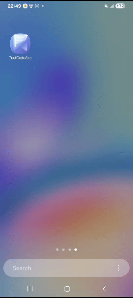
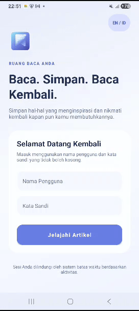
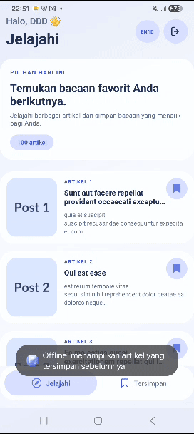
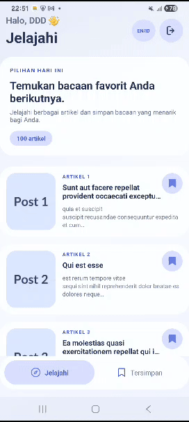
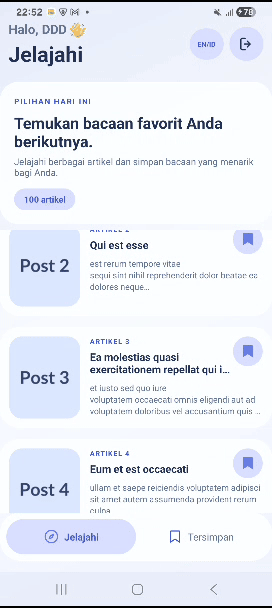
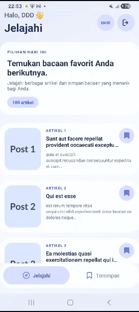

# TestCodeAsp

Aplikasi Android sederhana untuk menjelajahi posting, menyimpan bacaan favorit, dan membukanya kembali secara offline. Dibangun dengan Kotlin, XML Views, dan pola Model–View–Presenter (MVP).

## Fitur

- **Login demo** — masuk menggunakan username dan password yang tidak kosong, dengan validasi pada masing-masing kolom.
- **Dashboard posting** — menampilkan judul, isi, dan ilustrasi posting dari layanan publik.
- **Pull to refresh** — memperbarui daftar tanpa meninggalkan halaman.
- **Bookmark lokal** — menyimpan dan menghapus posting favorit melalui database Room.
- **Cache posting** — menampilkan data yang pernah dimuat ketika pembaruan dari jaringan gagal.
- **Penanganan kondisi halaman** — indikator loading, daftar kosong, pesan koneksi gagal, dan tombol coba lagi.
- **Sesi pengguna** — login tetap aktif selama belum melewati batas 180 detik tanpa interaksi; sesi yang kedaluwarsa diarahkan kembali ke login.
- **Toggle EN/ID** — penggantian locale dengan dialog progress untuk mencegah klik berulang selama perubahan berlangsung.
- **Splash screen** — menggunakan AndroidX SplashScreen dan langsung menuju dashboard jika sesi masih aktif.
- **Tampilan liquid glass** — kartu transparan, latar gradasi, dan ikon bookmark dengan aksen aqua–indigo.

Login bersifat simulasi dan belum terhubung ke layanan autentikasi. Password hanya digunakan untuk validasi input, tidak disimpan sebagai bagian dari sesi.

## Demo aplikasi

Demo berikut menggunakan GIF agar dapat dilihat langsung di README. Rekaman asli tetap tersedia di folder [`media`](media); versi GIF berada di [`media/demos`](media/demos).

### 1. Splash screen

Pembukaan aplikasi dari launcher dan tampilan logo splash.



### 2. Login screen

Pengisian username dan password, lalu masuk ke dashboard.



<details>
<summary>Lihat screenshot halaman login</summary>


</details>

### 3. Ganti bahasa EN/ID

Pergantian bahasa Indonesia dan Inggris dengan indikator loading.



### 4. Dashboard

Daftar posting, scroll, dan tombol bookmark pada kartu.


Saat jaringan tidak tersedia, posting yang sudah tersimpan tetap ditampilkan dengan pemberitahuan offline.



### 5. Bookmark

Membuka daftar artikel tersimpan dan menghapus bookmark.



### 6. Session timeout saat aplikasi terbuka

Perpindahan dari dashboard ke halaman login ketika tidak ada interaksi. Rekaman ini dibuat saat konfigurasi demo menggunakan timeout **10 detik**. Konfigurasi kode saat ini menggunakan **180 detik** (`SessionTimeoutPolicy.TIMEOUT_MS = 180_000L`). Rekaman pendek ini menampilkan bagian akhir masa tunggu hingga sesi berakhir.



### 7. Session timeout setelah keluar dan membuka aplikasi kembali

**Demo belum tersedia.** Rekaman yang ada belum memperlihatkan rangkaian keluar aplikasi, menunggu sesi habis, lalu kembali ke halaman login.

Skenario rekaman: login → tekan Home → tunggu lebih dari 180 detik sejak interaksi terakhir → buka kembali aplikasi → tampilkan halaman login.

<!-- Tambahkan setelah rekaman tersedia:

-->

## Teknologi

| Komponen | Implementasi |
| --- | --- |
| Bahasa | Kotlin |
| Antarmuka | XML Views, View Binding, Material Components |
| Arsitektur | MVP dengan repository |
| Proses asinkron | Kotlin Coroutines dan Flow |
| Jaringan | Retrofit, Gson, OkHttp |
| Database lokal | Room dengan KSP |
| Gambar | Glide |
| Preferensi sesi | SharedPreferences |
| Splash screen | AndroidX Core SplashScreen |
| Build | Gradle Kotlin DSL dan version catalog |

Versi dependensi dikelola di [`gradle/libs.versions.toml`](gradle/libs.versions.toml).

## Persiapan

- Android Studio yang mendukung Android Gradle Plugin 9.2.1.
- JDK 21 untuk menjalankan Gradle.
- Android SDK Platform 36.1.
- Emulator atau perangkat Android 7.0 / API 24 ke atas.
- Koneksi internet untuk sinkronisasi dependensi dan pengambilan posting pertama kali.

Konfigurasi aplikasi:

| Pengaturan | Nilai |
| --- | --- |
| Application ID | `co.id.bankbsi.superapp.testcodeasp` |
| Minimum SDK | 24 |
| Compile SDK | 36.1 |
| Target SDK | 36 |
| Gradle Wrapper | 9.4.1 |
| JVM Gradle | JDK 21 |
| Target bytecode Java | 11 |

## Build dan run

### Android Studio

1. Clone repository, lalu buka folder proyek melalui **File → Open**.
2. Pastikan Gradle JDK menggunakan JDK 21.
3. Pasang SDK Platform 36.1 melalui **SDK Manager** jika belum tersedia.
4. Tunggu Gradle Sync selesai.
5. Hubungkan perangkat dengan USB debugging aktif, atau jalankan emulator.
6. Pilih modul **app**, lalu tekan **Run**.

Android Studio akan membuat `local.properties` berisi lokasi SDK pada komputer masing-masing. File ini tidak perlu dimasukkan ke Git.

### Terminal

Jalankan perintah dari direktori utama proyek:

```sh
# macOS / Linux, jika wrapper belum executable
chmod +x gradlew

# Build APK debug
./gradlew assembleDebug

# Pasang APK debug ke perangkat atau emulator yang terhubung
./gradlew installDebug

# Buka halaman awal aplikasi
adb shell am start -n co.id.bankbsi.superapp.testcodeasp/.presentation.login.LoginActivity
```

Di Windows, gunakan `gradlew.bat` sebagai pengganti `./gradlew`. Perintah `adb` memerlukan Android SDK Platform-Tools pada `PATH`.

Hasil APK debug tersedia di:

```text
app/build/outputs/apk/debug/app-debug.apk
```

Untuk masuk, isi username dan password dengan nilai apa saja yang tidak kosong. Setelah login, posting dapat disimpan melalui tombol bookmark pada setiap kartu.

## Struktur kode

Kode utama berada di `app/src/main/java/co/id/bankbsi/superapp/testcodeasp/`.

```text
 testcodeasp/
 ├── TestCodeAspApp.kt          # Penyedia dependency aplikasi
 ├── data/
 │   ├── local/                # Database Room, entity, dan DAO
 │   ├── model/                # Model posting dan URL ilustrasi
 │   ├── remote/               # Definisi endpoint Retrofit
 │   └── repository/           # Penghubung API dan penyimpanan lokal
 ├── presentation/
 │   ├── core/                 # BaseActivity dan perilaku bersama
 │   ├── login/                # Activity, presenter, contract, validator
 │   ├── dashboard/            # Daftar posting dan pembaruan data
 │   ├── bookmark/             # Daftar posting tersimpan
 │   └── shared/               # Adapter RecyclerView
 └── utils/
     └── session/              # Penyimpanan sesi dan aturan timeout
```

Layout, string, tema, dan aset ikon berada di `app/src/main/res/`.

### Pembagian tanggung jawab

| Bagian | Tanggung jawab |
| --- | --- |
| `Activity` | Menampilkan data, menangani input, dan menjalankan navigasi |
| `Contract` | Mendefinisikan komunikasi presenter dengan tampilan |
| `Presenter` | Mengatur proses pemuatan data dan kondisi UI |
| `PostRepository` | Mengambil posting, mengamati cache, dan mengubah bookmark |
| `DAO` | Mengakses tabel Room dan menyediakan perubahan data melalui Flow |
| `TestCodeAspApp` | Menyediakan sesi, database, API, dan repository secara lazy |
| `BaseActivity` | Menangani timeout sesi, logout, dan pergantian locale |

Presenter membatalkan coroutine dan melepas referensi tampilan melalui `detach()` ketika Activity dihancurkan.

### Alur data posting

1. Dashboard mengamati posting dan ID bookmark dari Room.
2. Presenter meminta repository mengambil posting dari API.
3. Repository menyimpan hasil pengambilan ke database lokal.
4. Perubahan database diteruskan melalui Flow untuk memperbarui tampilan.
5. Jika jaringan gagal, posting yang sudah tersedia tetap ditampilkan. Jika cache kosong, halaman menampilkan pesan error dan tombol coba lagi.

Bookmark disimpan pada tabel terpisah dari cache posting. Operasi perubahan bookmark diserialisasi dengan `Mutex` di repository, sementara presenter mencegah permintaan ganda untuk posting yang sama.

### Sesi pengguna

`SessionManager` menyimpan status login, username, dan waktu interaksi terakhir di SharedPreferences. `SessionTimeoutPolicy` menentukan sisa waktu sesi dengan batas `180_000` milidetik.

`BaseActivity` memeriksa sesi saat halaman aktif kembali dan memperbarui waktu interaksi melalui event sentuh atau tombol. Waktu yang dihabiskan di background tetap diperhitungkan. Logout menghapus data sesi dan membersihkan back stack halaman yang memerlukan login.

### Bahasa dan loading

Tombol EN/ID pada login, dashboard, dan bookmark memanggil `toggleLanguage()` di `BaseActivity`. Dialog progress ditampilkan sebelum `AppCompatDelegate.setApplicationLocales()` dijalankan. Referensi dialog dibersihkan saat Activity dihancurkan atau konfigurasi berubah.

Resource default menggunakan bahasa Inggris, sedangkan terjemahan Indonesia berada di `values-in`. Toggle EN/ID mengganti bahasa antarmuka; konten posting tetap mengikuti bahasa dari API.

### Splash screen dan ikon

Tema awal `Theme.TestCodeAsp.Starting` diterapkan pada `LoginActivity`. Activity memanggil `installSplashScreen()` sebelum `super.onCreate()`, kemudian menggunakan tema aplikasi melalui `postSplashScreenTheme`.

Aset logo dibuat sebagai vektor Android agar tetap tajam pada berbagai ukuran:

- `ic_app_logo.xml` untuk halaman login.
- `ic_splash_logo.xml` untuk splash screen.
- `ic_launcher_foreground.xml` dan `ic_launcher_background.xml` untuk ikon adaptive.
- `ic_launcher_monochrome.xml` untuk ikon bertema sistem.

## Sumber data

| Data | Layanan |
| --- | --- |
| Posting | `https://jsonplaceholder.typicode.com/posts` |
| Ilustrasi utama | `https://picsum.photos/id/{postId}/200/200` |
| Ilustrasi cadangan | `https://placehold.co/200x200/DCE8FF/32456A/png?text=Post+{postId}` |

Jika kedua layanan gambar gagal, aplikasi menampilkan drawable cadangan. Teks posting dan bookmark dapat dibaca dari database lokal; ketersediaan gambar saat offline bergantung pada cache Glide.

Tidak diperlukan API key untuk konfigurasi layanan yang digunakan saat ini.

## Pemeriksaan proyek

```sh
# Unit test
./gradlew testDebugUnitTest

# Pemeriksaan statis Android
./gradlew lintDebug

# Instrumentation test; memerlukan perangkat atau emulator
./gradlew connectedDebugAndroidTest

# Build dan pemeriksaan sekaligus
./gradlew assembleDebug testDebugUnitTest lintDebug
```

Laporan pemeriksaan tersedia di:

- Unit test: `app/build/reports/tests/testDebugUnitTest/index.html`
- Lint: `app/build/reports/lint-results-debug.html`

Cakupan pengujian:

| Jenis | File | Skenario |
| --- | --- | --- |
| Unit | `LoginValidatorTest` | Input kosong, whitespace, kolom wajib, dan kredensial valid |
| Unit | `SessionTimeoutPolicyTest` | Sisa waktu, batas kedaluwarsa, reboot, dan nilai jam tidak valid |
| Unit data | `PostRepositoryTest` | Refresh API, cache saat offline, tambah/hapus bookmark, konversi entity, dan toggle bersamaan |
| Integrasi database | `PostDatabaseTest` | Query Room, urutan data, upsert, ID unik, dan pemisahan cache dari bookmark |
| UI | `LoginUiTest` | Validasi login kosong, penghapusan error saat mengetik, loading EN/ID, dan locale setelah Activity dibuat ulang |

Unit test repository memakai API dan DAO palsu sehingga tidak memerlukan jaringan atau emulator. Tes database menggunakan Room **in-memory** dan tidak mengubah database aplikasi. Tes UI memerlukan perangkat/emulator; setup menghapus sesi login aplikasi dan cleanup mengembalikan pilihan locale sebelumnya.

Pengujian otomatis belum mencakup seluruh alur dashboard dan bookmark melalui UI, autentikasi backend, maupun timeout setelah aplikasi lama berada di background. Tes timeout saat ini memverifikasi aturan waktunya secara langsung tanpa menunggu 180 detik.

## Pemecahan masalah

| Masalah | Yang perlu diperiksa |
| --- | --- |
| SDK tidak ditemukan | Lokasi `sdk.dir` di `local.properties` dan instalasi SDK 36.1 |
| Gradle gagal dijalankan | Gradle JDK atau `JAVA_HOME` menggunakan JDK 21 |
| `Permission denied` saat menjalankan wrapper | Jalankan `chmod +x gradlew` pada macOS / Linux |
| Perangkat tidak muncul | Aktifkan USB debugging dan periksa dengan `adb devices` |
| Posting gagal dimuat | Koneksi internet, akses layanan publik, dan tombol coba lagi |
| Kembali ke login setelah aplikasi ditinggalkan | Sesi berakhir setelah 180 detik tanpa interaksi |
| Teks posting tidak berubah setelah toggle EN/ID | Toggle mengganti bahasa antarmuka; isi posting berasal dari API |
| Error metadata AndroidX Core | Pertahankan Core 1.17.0 untuk konfigurasi SDK ini; Core 1.19.1 membutuhkan compileSdk 37 |

## Batasan

- Autentikasi masih berupa login demo.
- Bookmark tersimpan pada instalasi perangkat dan belum dipisahkan berdasarkan username.
- Data berasal dari layanan publik dan belum memiliki fitur membuat atau mengedit posting.
- Distribusi release memerlukan konfigurasi signing tersendiri.
